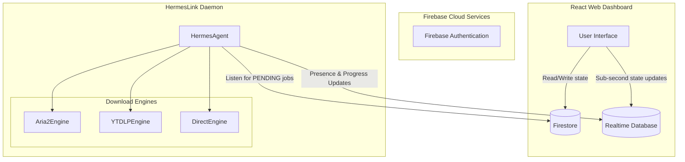

# HermesLink — Master Codebase Guide & API Reference

This document serves as the guide for the HermesLink codebase. It details the distributed architecture, directory structure, coding standards, core workflows, and acts as a complete code-level reference of **every file, class, function, parameter, and variable**.

---

## ⚡ Overview & Architecture

HermesLink is a distributed, real-time download manager that decouples **download scheduling (intent)** from **download execution (agent)**. 

* **Dashboard (Frontend)**: Submit download requests and configure queues from any web browser.
* **Database (Firebase Cloud)**:
  * **Firestore**: Persistent state storage (jobs, queues, historical summaries).
  * **Realtime Database (RTDB)**: Low-latency active progress metrics (`/jobs/<id>/progress`) and device keepalive / presence states (`/presence/<id>`).
* **Agent Daemon (Backend)**: Python worker running on home/office servers that listens to Firestore changes and executes downloads using dedicated engines.



---

## 📂 Folder Structure

```
HermesLink/
│
├── backend/
│   ├── cli_working/                # CLI-based printing and terminal clients
│   │   └── dashboard.py            # Restored terminal queues and jobs TUI
│   │
│   └── src/
│       ├── agent/                  # Daemon running on target download machines
│       ├── api/                    # FastAPI REST server
│       ├── core/                   # Business logic shared by API and agent
│       ├── tools/                  # Dedicated shared utilities (called by CLI, Agent & API)
│       ├── engines/                # Pluggable download backends
│       ├── firebase/               # Low-level Firebase Admin SDK operations
│       ├── models/                 # Pure domain data models (Job, QueueConfig, Device)
│       └── utils/                  # Cookie sync utilities
│
└── frontend/
    └── HermesLink_frontend/src/
        ├── components/             # Modular UI components
        ├── hooks/                  # Reactive real-time data sync hooks
        ├── contexts/               # React Auth contexts
        ├── config/                 # SDK setup files
        └── services/               # REST API client services
```

---

## 3. The "One File, One Work" Naming & Responsibility Rules

To ensure any developer can understand exactly what a file contains solely by inspecting its name, the codebase enforces a strict **separation of concerns**:

### File Naming Convention
* **Descriptive Nouns**: Filenames must be descriptive nouns or noun phrases representing their single responsibility.
* **React Hooks**: Must be camelCase starting with `use` (e.g. `useNewJobForm.js`).
* **React Components**: Must be PascalCase (e.g. `ActiveJobCard.jsx`).
* **Python Modules**: Must be snake_case (e.g. `queue_manager.py`).

### Rules for Defining New Files & Folders
1. **One Responsibility**: A file must have exactly **one** job. 
   * A visual component file (e.g., `NewJobModal.jsx`) must *only* handle formatting/overlay structures.
   * A form fields container (e.g., `NewJobForm.jsx`) must *only* render input elements.
   * A state logic provider (e.g., `useNewJobForm.js`) must *only* manage variables, hooks, validation, and network submissions.
2. **Models Are Dumb**: Files in `models/` must not import other modules or run any I/O calls. They are pure dataclasses.
3. **No Mixed Controllers**: Do not combine core logic (e.g., queue configs, state machines, sorting) inside a single "manager" file. Break them out into sub-managers.
4. **Make Directories for Collections**: If a concept groups more than two related files, wrap it in a folder (e.g., `queues/`, `jobs/`, `tools/`).

---

## 4. Detailed Backend Modules Reference

### 🚀 Agent Module (`backend/src/agent/`)

#### 📄 [hermes_agent.py](file:///home/prit/Project_Linux/Hermeslink/HermesLink/backend/src/agent/hermes_agent.py)
Orchestrates worker daemon lifecycle and Firestore listener hooks.
* **Classes**:
  * `HermesAgent`: Main worker daemon runner class.
* **Functions inside `HermesAgent`**:
  * `__init__(self, device_id: Optional[str] = None)`: Resolves unique device ID, configs, and storage profiles directory paths.
  * `start(self)`: Switches status to online and starts heartbeats, listener, and job processor queues.
  * `stop(self)`: Safely terminates listener subscriptions, active engines, and goes offline in RTDB.
  * `_go_online(self)`: Registers device info structure inside Realtime Database `/presence/{device_id}`.
  * `_heartbeat_loop(self)`: Periodic background heartbeat loop writing current timestamp to keepalive parameters.
  * `_listen_to_jobs(self)`: Attaches real-time listener snapshot query against Firestore collection for `PENDING` state jobs assigned to this device.
  * `_on_job_event(self, doc_snapshot, changes, read_time)`: Iterates on snapshots changes, calling `self._process_job` for newly enqueued items.
* **Important Variables**:
  * `self.device_id`: Active identifier for worker routing.
  * `self.storage_profiles`: Available folders mapped per machine.
  * `self.jobs_in_progress`: Dict mapping running `job_id` to its active `Thread` reference.

#### 📄 [job_bridge.py](file:///home/prit/Project_Linux/Hermeslink/HermesLink/backend/src/agent/job_bridge.py)
Bridges callback notifications between subprocess engines and databases.
* **Classes**:
  * `FirebaseJobBridge`: Bridges progress reporting values and terminal state mappings.
* **Functions inside `FirebaseJobBridge`**:
  * `__init__(self, job_id: str)`: Configures database keys.
  * `on_start(self)`: Transitions Firestore state to `RUNNING`.
  * `on_progress(self, progress_data: dict)`: Pushes speed, percentage, size, and ETA metrics to RTDB `progress` node.
  * `on_complete(self)`: Transitions Firestore state to `COMPLETED` and dequeues.
  * `on_failed(self, error_reason: str)`: Transitions Firestore state to `FAILED` with error text and dequeues.
  * `on_paused(self)`: Transitions Firestore state to `PAUSED`.
  * `on_stopped(self)`: Transitions Firestore state to `STOPPED` and dequeues.

#### 📄 [job_processor.py](file:///home/prit/Project_Linux/Hermeslink/HermesLink/backend/src/agent/job_processor.py)
Runs thread parameters verification and launches the engines.
* **Functions**:
  * `process_job(job_id: str, engine_config: dict, thread_limit: int, bridge: FirebaseJobBridge)`: Decides engine type (Aria2, YT-DLP, or Direct), configures routing directories, and launches the execution thread.

#### 📄 [job_monitor.py](file:///home/prit/Project_Linux/Hermeslink/HermesLink/backend/src/agent/job_monitor.py)
Monitors execution processes and scans RTDB for manual user cancellations.
* **Classes**:
  * `JobMonitor`: Active task inspector wrapper.
* **Functions inside `JobMonitor`**:
  * `monitor_engine(self, engine, job_id, bridge, auto_extract)`: Periodic polling thread tracking engine loops, looking up actions, and executing archive extractions upon completions.
  * `_check_actions(self, job_id, engine)`: Inspects `jobs/{job_id}/action` in RTDB. Invokes pause/resume signals or cancels process runs.

#### 📄 [archive_extractor.py](file:///home/prit/Project_Linux/Hermeslink/HermesLink/backend/src/agent/archive_extractor.py)
Handles extraction of zip, rar, and tar compression packages.
* **Classes**:
  * `ArchiveExtractor`: Extraction manager.
* **Functions inside `ArchiveExtractor`**:
  * `extract(self, file_path: str, destination_dir: str) -> bool`: Identifies suffix format and extracts content.

---

### 📦 API Server Module (`backend/src/api/`)

#### 📄 [server.py](file:///home/prit/Project_Linux/Hermeslink/HermesLink/backend/src/api/server.py)
Configures and initializes FastAPI applications.
* **Functions**:
  * `lifespan(app: FastAPI)`: Startup hook initializing download dirs, and running lifespan services (`JobRunner`, `ZombieSweeper`).
* **Variables**:
  * `app`: Global `FastAPI` instance.

#### 📄 [dependencies.py](file:///home/prit/Project_Linux/Hermeslink/HermesLink/backend/src/api/dependencies.py)
* **Functions**:
  * `get_current_user(request: Request) -> dict`: Validates Firebase ID Token Authorization Bearer headers.

#### 📄 [state.py](file:///home/prit/Project_Linux/Hermeslink/HermesLink/backend/src/api/state.py)
Declares and maps operational singletons.
* **Variables**:
  * `job_manager`: Global `JobManager` singleton.
  * `job_runner`: Global `JobRunner` singleton.
  * `job_controller`: Global `JobController` singleton.
  * `zombie_sweeper`: Global `ZombieSweeper` singleton.

#### 📄 [routes/jobs.py](file:///home/prit/Project_Linux/Hermeslink/HermesLink/backend/src/api/routes/jobs.py)
Endpoints for job creation, action handling, history listing, and reloading.
* **Classes (Pydantic Models)**:
  * `ProgressModel`, `EngineConfigModel`, `JobModel`, `JobListResponse`, `CreateJobRequest`, `JobActionRequest`
* **Functions**:
  * `job_to_model(job: Job) -> JobModel`: Translates pure dataclasses into serialized pydantic responses.
  * `get_all_jobs(user: dict = Depends(get_current_user))`: `GET /api/jobs`
  * `create_job(request: CreateJobRequest, user: dict = Depends(get_current_user))`: `POST /api/jobs`
  * `get_active_jobs(user: dict = Depends(get_current_user))`: `GET /api/jobs/active`
  * `get_job_history(user: dict = Depends(get_current_user))`: `GET /api/jobs/history`
  * `get_job(job_id: str, user: dict = Depends(get_current_user))`: `GET /api/jobs/{job_id}`
  * `job_action(job_id: str, request: JobActionRequest, user = ...)`: `POST /api/jobs/{job_id}/action`
  * `reload_jobs(user = ...)`: `POST /api/jobs/reload`

#### 📄 [routes/queues.py](file:///home/prit/Project_Linux/Hermeslink/HermesLink/backend/src/api/routes/queues.py)
* **Functions**:
  * `get_all_queues(user = ...)`: `GET /api/queues`. Serializes configurations and priorities for frontend dashboard tables.

#### 📄 [routes/media_info.py](file:///home/prit/Project_Linux/Hermeslink/HermesLink/backend/src/api/routes/media_info.py)
Resolves filenames and format configurations.
* **Classes (Pydantic Models)**:
  * `YtDlpInfoRequest`
* **Functions**:
  * `resolve_filename_route(url: str, user = ...)`: `GET /api/resolve-filename`
  * `get_yt_dlp_info(url: str, user = ...)`: `GET /api/yt-dlp/info`
  * `post_yt_dlp_info(request: YtDlpInfoRequest, user = ...)`: `POST /api/yt-dlp/info` (handles fallback serverless cookie injection)

---

### 📦 Core Logic Layer (`backend/src/core/`)

#### 📄 [job_manager.py](file:///home/prit/Project_Linux/Hermeslink/HermesLink/backend/src/core/job_manager.py)
Central manager for database states, job definitions, transitions, and lifecycle commands.
* **Classes**:
  * `JobManager`: Database broker and states coordinator.
* **Properties inside `JobManager`**:
  * `queues`: Proxies queue maps to `self.queue_manager.queues`.
  * `configs`: Proxies configurations to `self.queue_manager.configs`.
* **Functions inside `JobManager`**:
  * `create_queue()`, `delete_queue()`, `enqueue()`, `dequeue()`: Proxy calls delegating queue workloads to `self.queue_manager`.
  * `get_active_job()`, `process_queues()`: Proxy calls delegating scheduling workloads to `self.scheduler`.
  * `_recover_crash(self)`: Re-queues orphaned/running tasks back to pending state safely.
  * `create_job(self, config: dict, device_id: str, queue_id: str) -> Job`: Defines new job entities in Firestore.
  * `get_job(self, job_id: str) -> Optional[Job]`: Reads job cached items.
  * `list_jobs(self) -> List[Job]`: Returns list of all cached jobs.
  * `transition_job(self, job_id: str, new_state: JobState, error_reason: Optional[str])`: Coordinates valid state shifts.
  * `update_progress(self, job_id: str, progress_data: dict)`: Syncs active changes locally.
  * `save_jobs(self)`: Saves memory mappings into `app_state/admin_data` document.
  * `load_jobs(self)`: Reads document maps from Firestore `app_state/admin_data`.
  * `pause_job()`, `resume_job()`, `stop_job()`, `retry_job()`, `restart_job()`, `stop_all_jobs()`: State execution command APIs.

#### 📄 [queue_manager.py](file:///home/prit/Project_Linux/Hermeslink/HermesLink/backend/src/core/queue_manager.py)
Manages the mappings, properties, configurations, and structures of download queues.
* **Classes**:
  * `QueueManager`: Sub-controller for queue structures.
* **Functions inside `QueueManager`**:
  * `ensure_default_queue(self)`: Bootstraps the `'default'` queue configuration if missing.
  * `create_queue(self, queue_id: str, config: Optional[dict])`: Defines new custom queues.
  * `delete_queue(self, queue_id: str, force: bool)`: Flushes selected queue lists, transitioning contents to default paths.
  * `enqueue(self, job_id: str, queue_id: str)`: Appends job reference to targeted queue lists.
  * `dequeue(self, job_id: str)`: Removes job reference from all active queue lists.

#### 📄 [scheduler.py](file:///home/prit/Project_Linux/Hermeslink/HermesLink/backend/src/core/scheduler.py)
* **Classes**:
  * `Scheduler`: Sub-controller executing concurrency rules.
* **Functions inside `Scheduler`**:
  * `get_active_job(self) -> Optional[Job]`: Finds the local running job.
  * `process_queues(self)`: Processes all enabled queues in priority order, looking for `PENDING` candidates, checking schedule times, and starting jobs.

#### 📄 [job_controller.py](file:///home/prit/Project_Linux/Hermeslink/HermesLink/backend/src/core/job_controller.py)
Validates UI actions from the dashboard interface.
* **Classes**:
  * `JobController`: Evaluator for actions matching current states.
* **Functions inside `JobController`**:
  * `handle_command(self, job_id: str, action: str) -> dict`: Validates target state changes and executes the command on `JobManager`.

#### 📄 [job_runner.py](file:///home/prit/Project_Linux/Hermeslink/HermesLink/backend/src/core/job_runner.py)
Local downloader thread pool executing standalone server jobs.
* **Classes**:
  * `JobRunner`
* **Functions inside `JobRunner`**:
  * `start(self)` / `stop(self)`: Spawns runner loop thread pools.
  * `_run_loop(self)`: Loop checking local pending queues, running tasks, and bridging logs.

#### 📄 [zombie_sweeper.py](file:///home/prit/Project_Linux/Hermeslink/HermesLink/backend/src/core/zombie_sweeper.py)
* **Classes**:
  * `ZombieSweeper`: Active thread polling heartbeats.
* **Functions inside `ZombieSweeper`**:
  * `_sweep_loop(self)`: Scans device status listings. Marks jobs on dead machines (missing heartbeats for >120s) as `FAILED`.

---

### ⚙️ Executable Engines (`backend/src/engines/`)

#### 📄 [base_engine.py](file:///home/prit/Project_Linux/Hermeslink/HermesLink/backend/src/engines/base_engine.py)
* **Classes**:
  * `BaseEngine`: Abstract download engine interface.
* **Methods inside `BaseEngine`**:
  * `start(self)`: Spawns subprocess tasks.
  * `cancel(self)`: Aborts the active process runs.
  * `pause(self)` / `resume(self)`: Suspends/Restarts execution.

#### 📄 [aria2_engine.py](file:///home/prit/Project_Linux/Hermeslink/HermesLink/backend/src/engines/aria2_engine.py)
* **Classes**:
  * `Aria2Engine`
* **Functions inside `Aria2Engine`**:
  * `start(self)`: Starts connection strings, validates Range requirements, and launches Aria2 threads.
  * `cancel(self)` / `pause(self)` / `resume(self)`: Sends JSON-RPC command payloads to pause/resume/cancel downloads.
  * `ensure_daemon_running(self)`: Spawns the background `aria2c` process if not responsive.
  * `_check_resume_support(self)`: Resolves ranges and head attributes before initiating transfers.

#### 📄 [ytdlp_engine.py](file:///home/prit/Project_Linux/Hermeslink/HermesLink/backend/src/engines/ytdlp_engine.py)
* **Classes**:
  * `YTDLPEngine`
* **Functions inside `YTDLPEngine`**:
  * `start(self)`: Configures cookie paths, auth params, format options, and spawns the `yt-dlp` subprocess.
  * `cancel(self)`: Standard subprocess termination.
  * `pause(self)` / `resume(self)`: Sends native OS signals (`SIGSTOP`/`SIGCONT`) to pause/resume the subprocess.
  * `_monitor_output(self)`: Background thread parsing yt-dlp console logs via regex to calculate download progress.

#### 📄 [direct_engine.py](file:///home/prit/Project_Linux/Hermeslink/HermesLink/backend/src/engines/direct_engine.py)
* **Classes**:
  * `DirectEngine`
* **Functions inside `DirectEngine`**:
  * `start(self)`: Initiates connection via `requests.get(..., stream=True)`, looping chunks directly to target files.

---

### 🛠️ Shared Tools (`backend/src/tools/`)

#### 📄 [classifier.py](file:///home/prit/Project_Linux/Hermeslink/HermesLink/backend/src/tools/classifier.py)
* **Functions**:
  * `categorize_download(url: str, engine_type: str, job: Optional[Job] = None) -> str`: Dynamically sorts target folder routing names based on file extensions, patterns, or MIME headers.
  * `_get_category_from_mime(content_type: str) -> str`: Translates MIME structures into categories.

#### 📄 [name_extractor.py](file:///home/prit/Project_Linux/Hermeslink/HermesLink/backend/src/tools/name_extractor.py)
* **Functions**:
  * `resolve_filename(url: str) -> str`: Tries to resolve filenames using HTTP content-disposition header checks, YouTube oEmbed titles, or path basenames.
  * `_get_filename_from_headers(headers: dict) -> Optional[str]`: Parses RFC Content-Disposition strings.

---

### 🛠️ Database Setup Modules (`backend/src/firebase/`)

#### 📄 [firebase_client.py](file:///home/prit/Project_Linux/Hermeslink/HermesLink/backend/src/firebase/firebase_client.py)
Initializes Admin SDK credentials.
* **Functions**:
  * `initialize_firebase()`: Authenticates configurations.
  * `get_firestore_client()`, `get_realtime_database_reference()`, `get_auth_client()`: Returns authenticated Firestore, RTDB, and Auth clients.

#### 📄 [presence_writer.py](file:///home/prit/Project_Linux/Hermeslink/HermesLink/backend/src/firebase/presence_writer.py)
* **Functions**:
  * `set_device_online(device_id, presence_data)`, `update_device_presence_fields(device_id, updates)`, `update_device_heartbeat(device_id, timestamp_ms)`, `set_device_offline(device_id, timestamp_ms)`, `get_all_presence_data()`

#### 📄 [progress_writer.py](file:///home/prit/Project_Linux/Hermeslink/HermesLink/backend/src/firebase/progress_writer.py)
* **Functions**:
  * `update_job_progress(job_id, progress_data)`, `update_job_rtdb_fields(job_id, fields)`, `get_job_rtdb_data(job_id)`, `get_job_action_ref(job_id)`, `delete_job_action(job_id)`

---

## 🎨 Detailed Frontend Reference

### 🎣 Custom Hooks (`hooks/`)

#### 📄 [useNewJobForm.js](file:///home/prit/Project_Linux/Hermeslink/HermesLink/frontend/HermesLink_frontend/src/hooks/useNewJobForm.js)
State coordinator hook for new downloads wizard layouts.
* **States Managed**:
  * `url`, `type`, `queueId`, `destination`, `selectedStorageProfile`, `destinationPathIndex`, `loading`, `error`, `selectedDevice`, `formats`, `selectedFormat`, `fetchingFormats`, `scheduledAt`, `batchMode`, `batchUrls`, `autoExtract`, `showSuggestions`, `originalFileName`, `byUserFileName`, `useCustomName`, `fetchingFileName`, `dynamicFolder`, `currentStep`.
* **Hooks/Methods**:
  * `handleFetchFormats()`, `handleFileImport(e)`, `handleNext(e)`, `handleBack(e)`, `handleSubmit(e)`.

#### 📄 [useJobs.js](file:///home/prit/Project_Linux/Hermeslink/HermesLink/frontend/HermesLink_frontend/src/hooks/useJobs.js)
* **Variables**:
  * `jobs`: Array of live jobs matched to criteria, sorted by creation timestamp.
  * `loading`: Loading boolean indicator.

#### 📄 [useJobProgress.js](file:///home/prit/Project_Linux/Hermeslink/HermesLink/frontend/HermesLink_frontend/src/hooks/useJobProgress.js)
* **Parameters**:
  * `jobId` (string).
* **Return Values**:
  * `{ percent, speed, completed_length, total_length, eta, filename }`: Real-time progress metrics parsed from RTDB `/jobs/{jobId}/progress`.

#### 📄 [useQueues.js](file:///home/prit/Project_Linux/Hermeslink/HermesLink/frontend/HermesLink_frontend/src/hooks/useQueues.js)
* **Return Values**:
  * `{ queues, loading, createQueue, updateQueue, deleteQueue }`.

#### 📄 [useDevices.js](file:///home/prit/Project_Linux/Hermeslink/HermesLink/frontend/HermesLink_frontend/src/hooks/useDevices.js)
* **Return Values**:
  * `{ devices, loading }`: Real-time array of connected hardware presence blocks.

---

### 🎨 Modular UI Components (`components/`)

#### 📄 [features/NewJobModal.jsx](file:///home/prit/Project_Linux/Hermeslink/HermesLink/frontend/HermesLink_frontend/src/components/features/NewJobModal.jsx)
* **Props**: `isOpen` (bool), `onClose` (func), `onJobCreated` (func).
* **Role**: Renders the modal backdrop overlay and mounts `<NewJobForm />` inside.

#### 📄 [features/NewJobForm.jsx](file:///home/prit/Project_Linux/Hermeslink/HermesLink/frontend/HermesLink_frontend/src/components/features/NewJobForm.jsx)
* **Props**: `isOpen` (bool), `onClose` (func), `onJobCreated` (func).
* **Role**: Wizard steps layout binding input form fields to `useNewJobForm` hooks.

#### 📄 [jobs/ActiveJobCard.jsx](file:///home/prit/Project_Linux/Hermeslink/HermesLink/frontend/HermesLink_frontend/src/components/jobs/ActiveJobCard.jsx)
* **Props**: `job` (object), `actionLoading` (object), `handleAction` (func), `deviceMap` (object).
* **Role**: Progress layout, optimistic ticks updater, and command buttons triggers (Pause, Resume, Cancel).

#### 📄 [queues/QueueCard.jsx](file:///home/prit/Project_Linux/Hermeslink/HermesLink/frontend/HermesLink_frontend/src/components/queues/QueueCard.jsx)
* **Props**: `queue` (object), `onEdit` (func), `onDelete` (func), `onToggleEnabled` (func).
* **Role**: Displays priority, limits, stats, and command triggers for a single queue card.

#### 📄 [queues/CreateQueueModal.jsx](file:///home/prit/Project_Linux/Hermeslink/HermesLink/frontend/HermesLink_frontend/src/components/queues/CreateQueueModal.jsx)
* **Props**: `isOpen` (bool), `onClose` (func), `onCreate` (func), `actionError` (string).
* **Role**: Renders inputs overlay form for creating new queues.

#### 📄 [queues/EditQueueModal.jsx](file:///home/prit/Project_Linux/Hermeslink/HermesLink/frontend/HermesLink_frontend/src/components/queues/EditQueueModal.jsx)
* **Props**: `queue` (object), `onClose` (func), `onSave` (func), `actionError` (string).
* **Role**: Renders prefilled inputs form for modifying configurations.

#### 📄 [sections/ActiveJobsSection.jsx](file:///home/prit/Project_Linux/Hermeslink/HermesLink/frontend/HermesLink_frontend/src/components/sections/ActiveJobsSection.jsx)
* **Role**: Monitors active tasks list, handles card animations via GSAP, and controls New Job dialog launches.

#### 📄 [sections/QueueSection.jsx](file:///home/prit/Project_Linux/Hermeslink/HermesLink/frontend/HermesLink_frontend/src/components/sections/QueueSection.jsx)
* **Role**: Displays grids of queue cards and mounts creation/editing overlay modals.

#### 📄 [sections/HistorySection.jsx](file:///home/prit/Project_Linux/Hermeslink/HermesLink/frontend/HermesLink_frontend/src/components/sections/HistorySection.jsx)
* **Role**: Displays historical (Completed, Failed, Stopped) job tables with paginated navigation.

---

## 🔄 Core Workflows Reference

### 1. Device Presence Heartbeat Loop
```
Worker Agent boots
  ├── read CONFIG_FILE (obtains/persists unique device_id)
  ├── read config.yaml (resolves storage paths configurations)
  ├── write to RTDB: presence/{device_id} (status="online")
  └── run thread loop: periodically write current heartbeat timestamp to last_seen
```

### 2. Job Scheduling & Processing Loop
```
User schedules download via Dashboard Form
  └── Form posts payload to Firestore 'jobs' collection
  └── Firestore database triggers snapshot events
  └── Worker Agent listening to Firestore receives the event
  └── Worker spawns thread: job_processor.py
  └── Worker maps storage pathways & directories
  └── Worker invokes engine thread (e.g. aria2_engine.py)
```

### 3. Real-Time Controls Interface
```
User clicks "Pause" / "Resume" / "Cancel" on Dashboard
  └── Dashboard writes command (e.g., "PAUSE") directly to RTDB: jobs/{job_id}/action
  └── Real-time event listener inside worker thread intercepts changes
  └── Worker sends signals (SIGSTOP/SIGCONT for yt-dlp, or JSON-RPC pause for Aria2)
  └── Download engine responds, transitioning states in RTDB & Firestore
  └── Worker deletes command node in RTDB jobs/{job_id}/action
```
