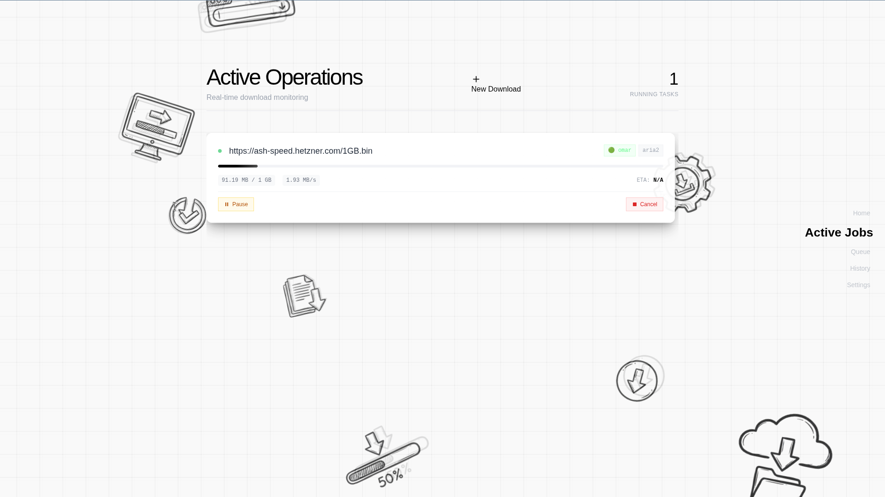
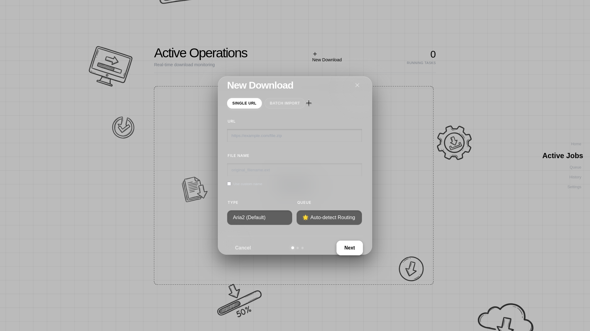
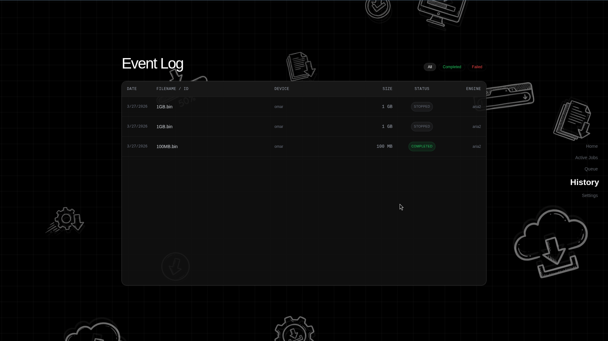
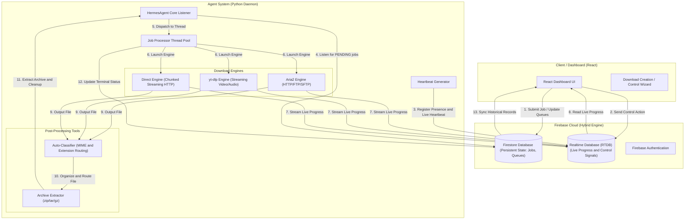

<div align="center">
  

# ⚡ HermesLink

### *A Distributed, Real-Time Remote Download Manager*

  Submit downloads from any device, anywhere. Execute them securely on your private download boxes.

  [](https://www.python.org/)
  [](https://react.dev/)
  [](https://firebase.google.com/)
  [](https://aria2.github.io/)
  [](LICENSE)

</div>

---

## 📖 Table of Contents

1. [Introduction](#-introduction)
2. [Media &amp; Previews](#-media--previews)
3. [Problem Faced](#-problem-faced)
4. [Algorithm &amp; Architecture](#-algorithm--architecture)
5. [Dataflow](#-dataflow)
6. [Steps to Operate](#-steps-to-operate)
7. [Setup &amp; Configurations](#-setup--configurations)
8. [Requirements](#-requirements)
9. [Conclusion](#-conclusion)
10. [Future Scope](#-future-scope)

---

## 📌 Introduction

**HermesLink** is a distributed, real-time download coordinator that decouples **download scheduling (intent)** from **download execution (agent)**.

Using a sleek, reactive web dashboard, you can trigger large downloads (such as Linux ISOs, deep learning datasets, archives, or high-definition streaming media) from your phone or laptop while on the go. These downloads execute immediately on your dedicated local machines (e.g., home media servers, office machines, or NAS storage boxes) that run the lightweight HermesLink Python agent.

By leveraging Google Firebase as a low-latency state synchronizer, HermesLink bypasses traditional firewall limits, ensuring instant control, live progress updates, and automated post-download sorting without requiring open public ports or heavy local bandwidth consumption on your portable client device.

---

## 🖼️ Media & Previews

<details open>
  <summary><b>📷 Screenshots</b></summary>
  <br>

<p align="center">
    
    <br><em>Real-time active downloads monitoring with progress updates</em>
  </p>

<p align="center">
    
    <br><em>New job dialog — customize target device, queue, and storage location</em>
  </p>

<p align="center">
    
    <br><em>Comprehensive download history log with statuses</em>
  </p>
</details>

<details>
  <summary><b>🎬 Walkthrough Videos</b></summary>
  <br>

  * **[System Overview & Walkthrough Video](https://drive.google.com/file/d/1DwzkUn6exMNWaIPu_VpJdxU_z9NSQSM7/view?usp=sharing)**
</details>

---

## ⚠️ Problem Faced

When designing a remote download management system, several technical and practical challenges must be addressed:

1. **Bandwidth Limitations on Mobile Devices:**
   Initiating large downloads directly on cell phones or laptops while traveling consumes expensive mobile data plans and drains battery life. Downloading files directly to the target storage box (e.g., home server) is the optimal path but usually requires local terminal access.
2. **NAT and Firewall Traversal (Access Security):**
   Private download boxes (like a NAS or a home server) typically operate behind symmetric NATs or double-layer routers. Standard methods to control these devices remotely (such as SSH, open HTTP APIs, or VPNs) require complex configuration, dynamic DNS setups, port forwarding, and introduce severe security vectors.
3. **Database Write and Read Quota Exhaustion:**
   Standard serverless architectures like Google Cloud Firestore are optimized for persistent data storage but have strict write limits and charge per write. Directly streaming high-frequency download telemetry (e.g., progress percentage, speed, ETA updated every 500ms) to Firestore would instantly exhaust free-tier document write quotas.
4. **Agent Lifecycle and Zombie Task Tracking:**
   If a download agent machine unexpectedly loses power or network connectivity while running active downloads, the system's database would remain marked as `RUNNING` indefinitely. There is a need to distinguish active, healthy workers from offline "zombie" states and clean up orphaned jobs.
5. **Dynamic Control of Decoupled Subprocesses:**
   Interrupted connections or user requests to pause/resume/cancel downloads must translate immediately into process control actions within local background tools (like `aria2c` or `yt-dlp`), even though the client and server have no direct peer-to-peer network connection.
6. **File Organization and Post-Download Processing:**
   Managing raw downloads requires manual sorting and extraction. Users need a system that intelligently routes files (e.g., documents, media, archives) to their respective directories and handles compressed files automatically.

---

## 🧠 Algorithm & Architecture

HermesLink addresses these issues using a modular architecture divided into four core areas: Presence, Scheduling, State Synchronization, and Subprocess Control.

```
┌──────────────────┐      ┌─────────────────┐      ┌───────────────┐      ┌─────────────┐
│  You (Dashboard) │ ───> │ Firebase Cloud  │ ───> │ Device Agent  │ ───> │ Local File  │
│  (Phone/Laptop)  │      │  (Firestore/DB) │      │ (Home Server) │      │ Storage     │
└──────────────────┘      └─────────────────┘      └───────────────┘      └─────────────┘
```

### 1. Real-Time Presence & Keepalive Tracking

* **Agent Online State:** When the background agent daemon starts (`hermes_agent.py`), it resolves its unique hardware ID and writes an online presence record to the Realtime Database (RTDB) node `/presence/{device_id}` containing hardware specs, status, and config parameters.
* **Keepalive Loop:** A dedicated thread runs every 30 seconds to update the `last_seen` epoch timestamp.
* **Zombie Sweeper:** The API server runs a background thread (`zombie_sweeper.py`) that monitors the `/presence/` status. If any agent's `last_seen` timestamp is older than 120 seconds, the agent is assumed crashed/offline. The sweep algorithm transitions all of that agent's `RUNNING` tasks to `FAILED` with the reason `"Device offline (Zombie cleanup)"` and frees up queue locks.

### 2. Priority-Based Queue Scheduling

The agent schedules tasks using an ordered priority queue resolver (`scheduler.py`):

1. **Fetch Enabled Queues:** Retrieves configurations of all enabled queues from Firestore, sorted by priority (ascending numerical order, i.e., priority 1 runs first).
2. **Evaluate Concurrency Constraints:** For each queue, it checks `max_parallel_jobs`. If the active job count on the device for that queue is below this limit, it proceeds.
3. **Task Dequeuing:** Pulls the oldest `PENDING` job assigned to the device under the current queue.
4. **Execution Dispatch:** Spawns a dedicated thread using `job_processor.py` to run the task, while respecting the `max_threads_per_job` configurations.

### 3. Hybrid State Synchronization (Write Optimization)

To avoid high Firestore billing costs, HermesLink uses a dual-database design:

* **High-Frequency Telemetry (RTDB):** Real-time progress updates (current speed, ETA, download progress, total size) are routed directly to the RTDB `/jobs/{job_id}/progress` node. Because RTDB charges for data bandwidth rather than individual database operations, this keeps operational costs at zero.
* **Persistent States (Firestore):** Crucial lifecycle states (`PENDING`, `RUNNING`, `COMPLETED`, `FAILED`, `STOPPED`) are committed directly to Firestore. This preserves transactional safety and persistent download histories.

```
High-Frequency Metrics (Speed, %, ETA) ────────► Firebase Realtime Database
Low-Frequency Life Cycle (States, Paths) ─────► Firebase Firestore DB
```

### 4. Process Control & OS Signaling

Commands from the dashboard (Pause, Resume, Stop) are piped in real-time through RTDB action nodes:

* **Aria2 Engine:** Uses JSON-RPC over local socket protocols to trigger native paused/resumed status parameters within the running `aria2c` process.
* **yt-dlp Engine:** Spawns process binaries via standard subprocess wrapper pipes. Pauses are executed by sending a POSIX `SIGSTOP` signal to the process ID (PID). Resumes send a `SIGCONT` signal. Terminations send a `SIGTERM` followed by a cleanup of partial files.
* **Direct HTTP Engine:** Downloads via python `requests` using progressive chunk buffer streaming. The download checks the action flag before processing each buffer block, enabling quick stops.

### 5. Automated Classification & Post-Processing

* **Auto-Classifier:** Post-download, the classifier analyzes the final file extension or inspects the HTTP response headers (MIME Content-Type). It maps the files into preset directories (e.g., `application/pdf` to `Documents`, `.mp4` to `Videos`, `.zip` to `Archives`).
* **Auto-Extractor:** If archive extraction is enabled on the job, the agent utilizes `archive_extractor.py` to extract zip, tar, gzip, or rar files directly to the target folder, cleaning up the original file on success.

---

## 🔄 Dataflow

This diagram represents the flow of user intent, execution events, database sync, and local storage routing:



---

## 🚶 Steps to Operate

Follow these steps to operate HermesLink from the Web Interface:

### 1. Log In to Dashboard

* Open the React web application in your browser.
* Log in with your admin credentials. Authentication is handled securely through **Firebase Authentication**.

### 2. Register Download Agents

* Launch the Python background daemon on your target home server/NAS.
* The device will register in real-time under the **Devices** list in your dashboard, indicating it is "Online" and displaying its configured storage path profiles.

### 3. Create or Configure Queues

* Navigate to the **Queues** tab on the sidebar.
* Click **Create Queue** to add a new download lane. You can set the queue's:
  * **Max Parallel Jobs**: Limits concurrent downloads.
  * **Max Threads Per Job**: Controls network thread allocation.
  * **Priority Level**: Determines scheduling order relative to other queues.
  * **Status**: Toggle to enable/disable processing.

### 4. Create a Download Job (New Job Wizard)

* Click **New Job** to open the wizard modal.
* **Step 1 (Basic Details):** Paste the target download URL. HermesLink automatically resolves the file name and maps the engine:
  * Standard HTTP/FTP targets route to the high-performance **Aria2** daemon.
  * YouTube, Twitch, or video platform links route to the **yt-dlp** engine.
  * Basic downloads fall back to **Direct HTTP**.
* **Step 2 (Configuration):** Select the target download Device, select the Queue, choose a Storage Profile (e.g., Default, Movies, Downloads), and toggle **Auto-Extraction** if downloading compressed archives.
* **Step 3 (Customization):** Optionally customize the output file name or directory routing paths.
* **Step 4 (Submit):** Submit the job. The task transitions to `PENDING` and is picked up by the target agent.

### 5. Monitor and Control Active Jobs

* Navigate to **Active Downloads**.
* You will see the download cards rendering real-time metrics: progress bar, download speeds (MB/s), completed vs. total size, and dynamic ETAs.
* Click **Pause** or **Resume** to pause or continue the transfer. Click **Stop** to cancel the process.

### 6. View History

* Completed, stopped, or failed tasks are automatically moved to the **History** section.
* Detailed error logs are preserved for failed downloads to help troubleshoot network issues.

---

## ⚙️ Setup & Configurations

Follow this step-by-step guide to install and configure both components of the application.

### 1. Firebase Cloud Setup

1. Open the [Firebase Console](https://console.firebase.google.com/) and click **Add Project**.
2. **Firestore Database:** Under "Build", select Firestore Database and click **Create Database**. Set permissions to **Test Mode** (or update with rules in `firestore.rules`).
3. **Realtime Database:** Select Realtime Database and click **Create Database**. Note the database reference URL (e.g., `https://<your-project-id>-default-rtdb.firebaseio.com`).
4. **Authentication:** Go to Auth, click **Get Started**, enable **Email/Password**, and create a user profile for yourself.
5. **Service Account Keys:**
   * Navigate to **Project Settings (Gear Icon) -> Service Accounts**.
   * Click **Generate New Private Key**.
   * Save the downloaded JSON file as `backend/serviceAccountKey.json`.
6. **Web App registration:**
   * Go to Project Settings -> General.
   * Under "Your Apps", click the Web icon (`</>`) and register an app.
   * Copy the firebase config keys (API Key, Auth Domain, Project ID, databaseURL).

### 2. Configure Backend Agent

Go to the `backend` directory, create a `.env` file, and fill in the environment keys:

```env
GOOGLE_APPLICATION_CREDENTIALS=serviceAccountKey.json
FIREBASE_DATABASE_URL=https://<your-project-id>-default-rtdb.firebaseio.com
```

Create a `backend/config.yaml` configuration file to configure local paths:

```yaml
device_name: "My Home Server"
storage_profiles:
  default:
    name: "Default Downloads"
    paths:
      - "/home/user/Downloads/HermesLink"
  movies:
    name: "Movies Directory"
    paths:
      - "/mnt/media/Movies"
```

### 3. Configure Frontend Client

Go to the `frontend/HermesLink_frontend` directory, create `.env`, and populate it with your Firebase Web App configuration:

```env
VITE_FIREBASE_API_KEY=your_api_key_here
VITE_FIREBASE_AUTH_DOMAIN=your_project_id.firebaseapp.com
VITE_FIREBASE_PROJECT_ID=your_project_id
VITE_FIREBASE_STORAGE_BUCKET=your_project_id.appspot.com
VITE_FIREBASE_MESSAGING_SENDER_ID=your_messaging_sender_id
VITE_FIREBASE_APP_ID=your_app_id
VITE_FIREBASE_DATABASE_URL=https://your_project_id-default-rtdb.firebaseio.com
```

### 4. Running the Project Locally

#### A. Starting the Python Agent Daemon:

```bash
cd backend
python -m venv .venv
source .venv/bin/activate
pip install -r requirements.txt

# Run the agent worker daemon
cd src
python agent.py
```

#### B. Starting the API server (Optional):

```bash
cd backend/src
python api_server.py
```

#### C. Running the React Web App:

```bash
cd frontend/HermesLink_frontend
npm install
npm run dev
```

---

## 🖥️ Production Daemon Setup (Linux / systemd)

To run the HermesLink Agent continuously in the background on your Linux server, configure systemd user services.

### 1. Link Control CLI

Link the control utility script to your path:

```bash
mkdir -p ~/.local/bin
ln -s "$(pwd)/hermeslink-ctl.sh" ~/.local/bin/hermeslink

# Reload user systemd configuration
systemctl --user daemon-reload
```

### 2. Configure Service Units

Create user service definitions under `~/.config/systemd/user/`:

#### `~/.config/systemd/user/hermeslink-agent.service`

```ini
[Unit]
Description=HermesLink Background Agent
After=network.target

[Service]
Type=simple
Environment="PYTHONUNBUFFERED=1"
WorkingDirectory=/absolute/path/to/HermesLink/backend/src
ExecStart=/absolute/path/to/HermesLink/backend/.venv/bin/python agent.py
Restart=always
RestartSec=10

[Install]
WantedBy=default.target
```

#### `~/.config/systemd/user/hermeslink-api.service`

```ini
[Unit]
Description=HermesLink API Server
After=network.target

[Service]
Type=simple
Environment="PYTHONUNBUFFERED=1"
WorkingDirectory=/absolute/path/to/HermesLink/backend/src
ExecStart=/absolute/path/to/HermesLink/backend/.venv/bin/python api_server.py
Restart=always
RestartSec=10

[Install]
WantedBy=default.target
```

### 3. Service Commands

Use the `hermeslink` CLI to manage the daemon:

* **Start Services:** `hermeslink start`
* **Stop Services:** `hermeslink stop`
* **Check Status:** `hermeslink status`
* **Follow Logs:** `hermeslink logs`
* **Enable Boot Autostart:** `hermeslink enable`

---

## 📋 Requirements

### System Requirements

* **Operating System:** Cross-platform (Linux, macOS, Windows).
* **Python Runtime:** Python 3.10 or higher.
* **Node Environment:** Node.js 18 or higher (for the frontend client).

### Binary Dependencies

To use all download engine handlers, ensure the following utilities are installed and available in your environment path:

* **aria2c:** The utility binary for high-performance chunked downloads.
  * Install on Debian/Ubuntu: `sudo apt install aria2`
  * Install on Arch Linux: `sudo pacman -S aria2`
  * Install on macOS: `brew install aria2`
* **yt-dlp:** For processing streaming video URLs.
  * Install on Debian/Ubuntu: `sudo apt install yt-dlp`
  * Install on Arch Linux: `sudo pacman -S yt-dlp`
  * Install on macOS: `brew install yt-dlp`

### Python Library Dependencies

Detailed packages are listed in `backend/requirements.txt`:

* `firebase-admin`
* `fastapi`
* `uvicorn`
* `pyyaml`
* `requests`
* `pydantic`

---

## 🎯 Conclusion

HermesLink solves the problem of downloading large files remotely by decoupling scheduling from execution. It utilizes a hybrid database approach to optimize costs and bypass firewall/NAT traversal issues, allowing you to trigger and monitor downloads securely on your home servers from any mobile web browser.

Through its modular design, auto-classification tools, and flexible engine wrappers (`aria2`, `yt-dlp`, Direct HTTP), HermesLink turns any network-connected computer into an automated, remote-controlled download box.

---

## 🔮 Future Scope

* **Chrome & Firefox Web Extension:** Build web extensions to click-to-download links directly from a browser and send them to the server agent.
* **Bandwidth Throttling:** Add speed limitation sliders in the UI to dynamically adjust the max download speeds for individual queues or devices.
* **Torrent Magnet File Explorer:** Integrate advanced magnet-link inspectors to parse metadata and select specific files from a torrent bundle before starting the download.
* **Notification System:** Send immediate completions and failure alerts to third-party endpoints like Discord, Telegram, or Slack using custom webhook integrations.
* **Multi-User Permission Matrices:** Allow primary admins to create restricted access user accounts, allocating download folders and limits per user.
